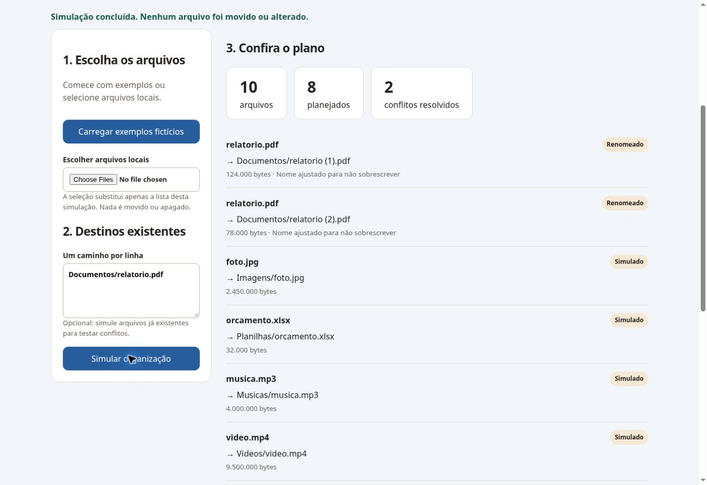

# Organizador de Downloads

**Reconstrução independente em Python.** O arquivo original não foi localizado; esta implementação não é apresentada como recuperação dele. Ferramenta local gratuita, sem dependências externas ou APIs.

## Uso no Windows

Requer Python 3.10 ou superior. Primeiro, teste em uma pasta com arquivos fictícios:

```powershell
py organizador.py "C:\PastaDeTeste"
```

O comando acima apenas simula: não cria diretórios, logs ou arquivos. Confira o plano antes de executar a opção que move arquivos:

```powershell
py organizador.py "C:\PastaDeTeste" --aplicar
```

Categorias: Documentos, Imagens, Videos, Musicas, Planilhas, Compactados e Outros. Processa somente arquivos da pasta indicada; não percorre subpastas. Ignora links simbólicos, arquivos ocultos pelo nome, downloads incompletos e seu próprio log. Homônimos recebem sufixos como `arquivo (1).pdf`. Destinos existentes não são sobrescritos.

O modo aplicado registra resultado por arquivo em `organizador-operacoes.jsonl`. O log contém caminhos locais: não o publique se incluir nomes pessoais. Não há envio de dados pela rede. Arquivos abertos ou modificados por outros programas podem impedir a movimentação; feche downloads e aplicativos antes de aplicar. Não é um serviço automático e não possui desfazer automático; preserve backups independentes.

## Testes

```powershell
py -m unittest discover -s tests -v
```

Testes usam exclusivamente arquivos fictícios em diretórios temporários e cobrem simulação sem efeitos, categorias, preservação de conteúdo, nomes repetidos, subpastas, arquivos incompletos, links, execução repetida, cópia alternativa e falhas.

## Executável Windows

O executável não foi gerado nem homologado neste ambiente Linux. Para gerar gratuitamente em um Windows com Python e PyInstaller:

```powershell
py -m venv .venv
.\.venv\Scripts\python.exe -m pip install pyinstaller
.\.venv\Scripts\python.exe -m PyInstaller --onefile --name OrganizadorDownloads organizador.py
```

O resultado fica em `dist\OrganizadorDownloads.exe` e precisa ser testado em pastas descartáveis antes de distribuição. Não há instalador, assinatura digital ou interface gráfica nesta versão. A compatibilidade com Windows está preparada no código, mas precisa de validação no sistema real.

## Resultado desta revisão

**10 testes aprovados em Linux**, somente com arquivos fictícios e pastas temporárias. Não houve acesso aos Downloads reais do usuário. Compatibilidade e executável Windows ainda não homologados.

## Demonstração web independente

Interface em HTML, CSS e JavaScript. Seleção de exemplos ou arquivos locais, categorias, simulação, destinos, resolução de conflitos e download de resumo JSON. Os arquivos não são enviados: apenas nomes e tamanhos são processados em memória no navegador. Atualizar a página descarta a seleção; não há persistência dos nomes. Não move arquivos, não cria pastas e não executa o Python.

Execute `python3 -m http.server 8000` nesta pasta e abra http://localhost:8000. Testes web: `node --test core.test.mjs` — 4 aprovados. Python: 10 testes aprovados novamente em 30/10/2026. No navegador da prévia técnica foram verificados: simulação vazia, dez exemplos, dois conflitos resolvidos com destino preexistente, arquivo fictício local e resumo JSON com dez operações. Iframe de 390 px, sem rolagem horizontal.

**Publicação pendente:** criação de repositório público bloqueada pela revisão automática por exigir autorização no corpo da conversa. Código e documentação estão preparados; nenhuma URL pública nova é apresentada como existente. Repositório pretendido: `matheuz-code/organizador-downloads`.

## Captura da prévia técnica


